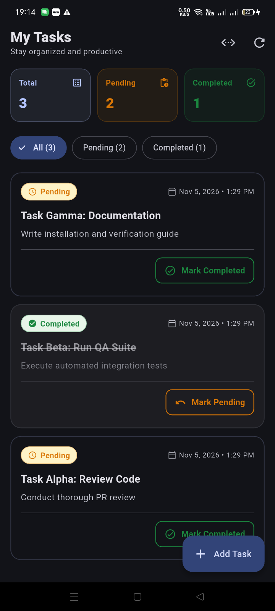

# Mini Task Manager Mobile Application

A complete full-stack Task Manager mobile application built with **Flutter (Material 3)** and a **Python FastAPI** backend powered by **SQLite** and **SQLAlchemy**.

---

## 📱 Application Overview

The application satisfies every core requirement of the technical assignment:
- **View All Tasks**: Real-time task dashboard with summary counters (Total, Pending, Completed).
- **Add Tasks**: Form with mandatory title validation and optional description.
- **Status Management**: Seamlessly toggle between **Pending** and **Completed** with instant UI updates and SQLite persistence.
- **Pull-to-Refresh**: Swipe to sync with the backend server.
- **Persistence Across Restarts**: All records remain intact in SQLite after closing or restarting the app.

---

## 📸 Screenshots

| Physical Device Live UI |
| :---: |
|  |

---

## 🛠️ Architecture & Tech Stack

```
mini_task_manager/
├── backend/
│   ├── app/
│   │   ├── main.py              # FastAPI application, CORS & startup table creation
│   │   ├── database.py          # SQLite engine & SQLAlchemy session injection
│   │   ├── models.py            # SQLite tasks table definition
│   │   ├── schemas.py           # Pydantic validation schemas
│   │   ├── routes/
│   │   │   └── tasks.py         # REST API routes (GET, POST, PATCH)
│   │   └── services/
│   │       └── task_service.py  # Business logic & database transactions
│   ├── tests/
│   │   └── test_tasks.py        # Pytest test suite (11 test cases)
│   ├── test_qa_scenario.py      # End-to-end 10-step QA scenario test
│   ├── requirements.txt         # Dependencies
│   └── README.md
├── mobile/
│   ├── lib/
│   │   ├── config/api_config.dart          # Centralized API URLs & IP presets
│   │   ├── models/task.dart                # Task model & JSON serialization
│   │   ├── services/api_service.dart       # REST HTTP client & error handling
│   │   ├── widgets/task_card.dart          # Material 3 task card with toggle action
│   │   ├── widgets/status_badge.dart       # Status badge (Pending vs Completed)
│   │   ├── screens/home_screen.dart        # Dashboard, filters & pull-to-refresh
│   │   ├── screens/add_task_screen.dart    # Add task form with input validation
│   │   └── main.dart                       # App entry point & Material 3 theme
│   ├── test/widget_test.dart               # Flutter unit & widget tests
│   └── pubspec.yaml
├── screenshots/
│   └── task_manager_home.png    # Live screenshot from physical Android phone
├── README.md
└── .gitignore
```

### Technology Highlights
- **Mobile Client**: Flutter 3.44+ / Dart 3.12+, Material 3 UI, HTTP JSON client, responsive layouts.
- **Backend API**: Python 3.10+ / FastAPI, SQLAlchemy 2.0 ORM, Pydantic 2.0 schemas.
- **Database**: SQLite (`tasks.db`), persistent storage with auto-created schema.
- **Communication**: REST APIs over HTTP JSON.

---

## 🔌 API Specification

| Method | Endpoint | Description | Request Body | Response Code |
| :---: | :--- | :--- | :--- | :---: |
| `GET` | `/tasks/` | Retrieve all tasks | *None* | `200 OK` |
| `POST` | `/tasks/` | Create a new task (Pending) | `{"title": "...", "description": "..."}` | `201 Created` |
| `PATCH` | `/tasks/{id}/` | Update task status | `{"status": "Completed"}` | `200 OK` |

Interactive Swagger documentation is available at `http://127.0.0.1:8000/docs` while the backend is running.

---

## 🚀 Setup & Execution Guide

### 1. Backend Setup (FastAPI)

1. Open a terminal and navigate to the `backend/` directory:
   ```bash
   cd backend
   ```

2. Create and activate a Python virtual environment:
   ```bash
   # Windows PowerShell:
   py -m venv .venv
   .\.venv\Scripts\Activate.ps1

   # macOS / Linux:
   python3 -m venv .venv
   source .venv/bin/activate
   ```

3. Install dependencies:
   ```bash
   pip install -r requirements.txt
   ```

4. Start the FastAPI backend:
   ```bash
   uvicorn app.main:app --host 0.0.0.0 --port 8000 --reload
   ```
   *The server will start listening at `http://0.0.0.0:8000` and automatically create `tasks.db`.*

5. Run automated backend tests:
   ```bash
   pytest -v
   ```

---

### 2. Mobile Setup (Flutter)

#### Running on a Physical Android Phone via USB Debugging (Recommended)

1. Connect your Android phone to your computer via USB and enable **USB Debugging** in Developer Options.
2. In your terminal, reverse port `8000` so your phone reaches your computer's FastAPI server:
   ```bash
   adb reverse tcp:8000 tcp:8000
   ```
3. Navigate to the `mobile/` directory:
   ```bash
   cd mobile
   ```
4. Run the application:
   ```bash
   flutter run
   ```

#### Running on Android Emulator
If using an emulator, the app's built-in network config automatically resolves `http://10.0.2.2:8000` (or tap the Ethernet Settings icon in the app bar to select the Emulator preset).

5. Run Flutter widget tests:
   ```bash
   flutter test
   ```

---

## 🧪 Verification & QA Testing

- **Backend Unit Tests**: 11/11 tests passing (`pytest -v`).
- **Flutter Widget Tests**: 5/5 tests passing (`flutter test`).
- **Flutter Analysis**: Zero lint or analyzer warnings (`flutter analyze`).
- **End-to-End QA Scenario**: Verified via `backend/test_qa_scenario.py` validating task creation, completion, status reversal, and data persistence across server and client restarts.
